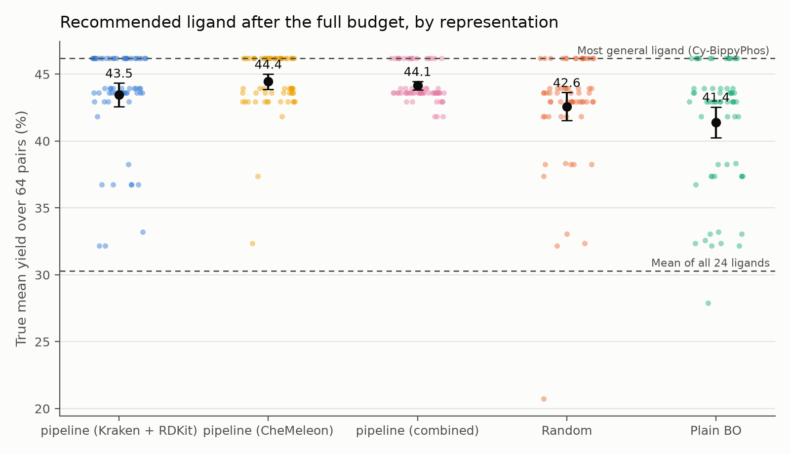
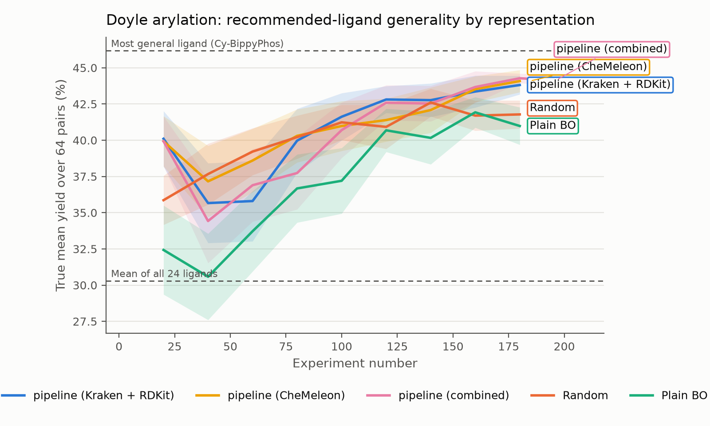
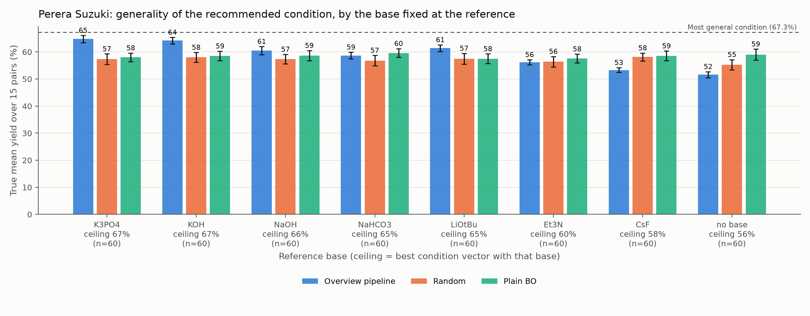
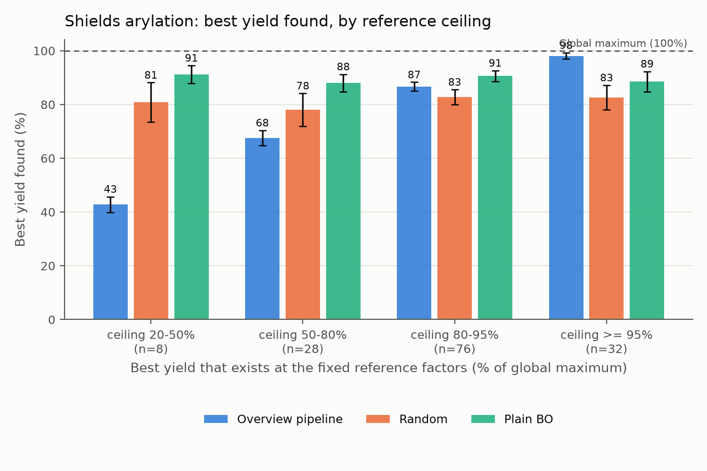
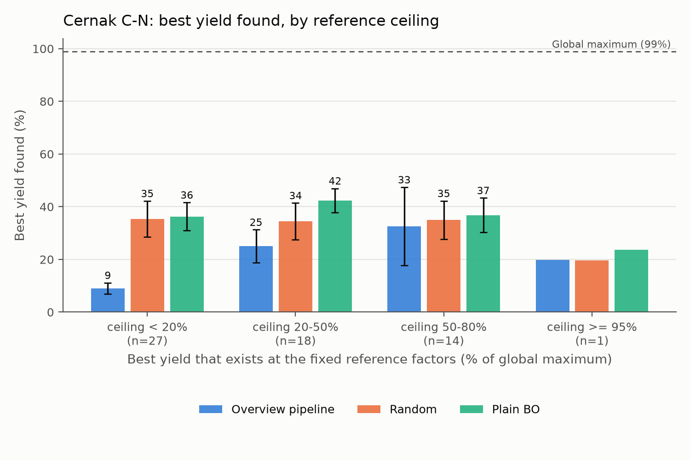
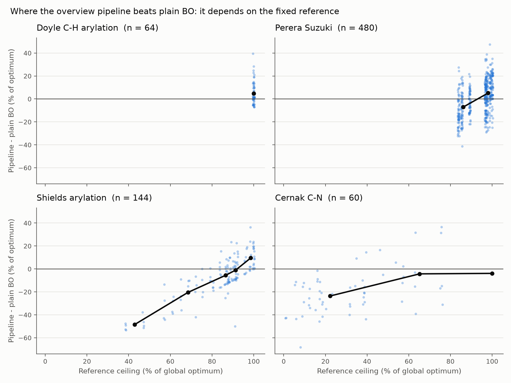
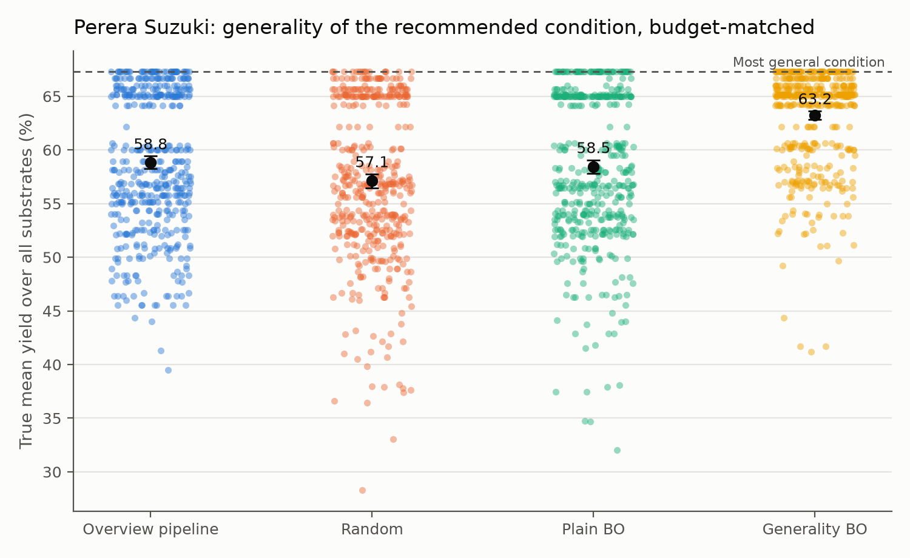

# cat_bots: results summary (October 2026)

**What this is:** an overview of the methods, benchmarks and results. The original pipeline design is in
[`project_overview.md`](../project_overview.md); [`research_log.md`](research_log.md) has every number,
decision and date behind this summary.

---

## TL;DR

- With the SDL experiments stopped, we turned the WP1–WP2 statistical pipeline into a **tested Python
  package (`catbots`)**. We **benchmark it in simulation**, using four published, fully measured HTE
  datasets as stand-ins for the robot.
- Experiments follow the **overview's stage batches** (KS 60 ligands → 12 × metals → 48 → 12 → 36 substrates
  → 4 × 24 → final space → BO on 25% of it), capped where a dataset is smaller. Every run is compared
  with **random sampling and plain Bayesian optimisation given exactly the same number of experiments**.
- **When the pipeline's fixed reference condition is sensible, it is significantly better than plain BO
  and random on every dataset where we can test that.** It finds more general conditions on
  substrate-rich problems:
  - Doyle: a top-3 ligand in 86% of runs vs 44% for BO;
  - Suzuki: +3.5 points generality vs BO.
- **Its main weakness is the overview's assumption that undesigned factors** (base, temperature,
  concentration) **can be fixed up front.** With a poor reference it is capped well below what BO finds;
  this is what decides the outcome on the single-substrate datasets.
- **We tested a fix: a 30-experiment statistical pre-screen ("WP0") that chooses the fixed factors from
  data.** It picks much better reference conditions (Shields: 95% vs 84% of the optimum achievable), and
  the pipeline improves on every dataset. But plain BO, given the same extra 30 experiments, still wins
  on the single-substrate datasets. **Conclusion: the pipeline is a tool for finding *general*
  conditions, not a faster single-substrate yield optimiser.**
- **Decisive last test: a BO that directly targets generality** (the pipeline's own objective) **ties the
  pipeline on Doyle and beats it on Suzuki** (63.2 vs 58.8). On these benchmarks the pipeline is a sound,
  interpretable, batch-friendly workflow, but **not** a more sample-efficient optimiser than a well-posed BO.
- **Foundation-model embeddings help, as a consistent trend but not significantly.** Both arms using CheMeleon
  (a pretrained molecular graph network) beat DFT descriptors alone: combined is the most reliable,
  CheMeleon alone has the best mean. CheMeleon also removed a substrate-clustering failure.

---

## 1. Why and what

The physical experiments were dropped because the target cyclisation chemistry proved too complex. The
pipeline itself (screening → low-data models → reduced space → BO) is the transferable contribution, so we:

1. moved it from standalone scripts into a package with tests;
2. replaced the robot with **oracles**: published datasets where every reaction in the grid was measured,
   so an "experiment" is a lookup of the real yield;
3. asked, for each dataset: *does the overview's statistical reduction beat simply running BO (or random
   sampling) with the same experimental budget?*

---

## 2. What changed from the original pipeline

### 2.1 Code

| Before | Now |
|---|---|
| ~25 scripts in `src/ligand_screening/`, `src/substrate_screening/`, `src/utils/`, each with hard-coded relative paths | `src/catbots/` package (`pip install -e .`), 39 automated tests. Old scripts kept for reference only |
| Kennard-Stone copied into 6 files | One implementation (`catbots.selection`), tested to select **identically** to the original |
| Stages run by hand, with manual CSV steps in between | `catbots.pipeline.run_overview_pipeline`: all stages in one call, every experiment logged with its stage, no reaction ever repeated |
| — | `ReactionOracle`: a measured dataset that answers "experiments" and counts the budget |

### 2.2 Problems found in the original scripts (fixed in the package)

- `kennard_stone_wp2b.py` read model files from a different folder than `model_training_wp2b1.py` wrote them to.
- Several scripts needed `fey_monop.csv`, which is no longer in the repo; descriptors are now Kraken.
- `clustering_wp2c.py` looked for a `SMILES` column that `initial_substrates.csv` doesn't have.
- `reclustering_wp2c.py` clustered the multitask model's coefficients. There is one row per *trained*
  substrate (5), so k = 8 was impossible and the other active substrates were ignored.
- `metal_filtering_wp2a.py`'s "strict" rule was effectively the opposite of the overview's: it kept a
  metal only if it worked with *every* ligand, while the overview drops a metal only if it fails with *all*.
- `model_training_wp2c.py` uses a scikit-learn option that will be removed in 1.10.

### 2.3 Method decisions (deviations and choices), each documented in the research log

| Decision | Why |
|---|---|
| **Budgets follow the overview's stage batches, capped at pool size** (e.g. "KS 60 ligands" → all 24 Doyle ligands); final BO = 25% of the reduced space | The point is the overview's small-data regime |
| **WP2A metal screen compared with matched metal-free controls** (dead-zone rule on yield *gain over control*) | The Cernak data show strong metal-free background chemistry (SNAr/aryne); raw yields would make Cu look active |
| **Factors the overview doesn't design** (base, concentration, temperature) **are fixed at the run's reference**; solvent is screened at the reference and opened in the final space | Faithful to the overview, which fixes everything it doesn't list |
| **"Substrate 1" / the reference condition is swept over every possibility** (64–480 runs per dataset) instead of being chosen once | The overview relies on expert choice; the sweep shows how much results depend on it |
| Model choice by leave-one-out cross-validation instead of 80/10/10 splits | At 12–72 points the original splits leave 1–3 test points |
| **Final-space ligands: measured ligands ranked by their observed average, the multitask model only for unmeasured ones** | The model's ranking of already-measured ligands dropped the best Doyle ligand in half the runs |
| Kraken descriptors: the correlation-screened set `kraken_reduced_0.7_no_delta.csv` (34 descriptors), matched by InChIKey | Same ligand coverage as the full table; InChIKey matching recovers ligands the SMILES merge missed |
| **Generality** = true mean yield across *all* substrates of the recommended condition vector; single-substrate datasets use best yield found | The overview's goal: one condition vector that works across substrates |

### 2.4 New capabilities

- **CheMeleon embeddings** (foundation model, Chemprop-based) computed on the GPU and stored, so the core
  package needs no PyTorch.
- **"Combined" representation:** CheMeleon PCA components + Kraken (ligands) / RDKit (substrates).
- **Figures for every run:** best yield vs experiment number, generality vs experiment number, a
  per-stage trace, final comparisons, and breakdowns by reference quality. Each comes with a CSV of the
  plotted numbers.
- Environments: `cat-bots` (re-locked; pytest added) and `catbots-gnn` (RTX 5090, PyTorch CUDA 13,
  Chemprop 2.3).

---

## 3. Benchmark datasets

| Dataset | Reactions | What varies | Pipeline stages it can test | Objective |
|---|---|---|---|---|
| **Doyle C–H arylation** (Wang et al., *Nature* 2024) | 1,536, full grid | 24 ligands × 8 aryl bromides × 8 imidazoles | WP2B (capped) + WP2C + final BO | Generality across 64 substrate pairs |
| **Perera Suzuki** (*Science* 2018; GOLLuM copy) | 5,760, full grid | 15 substrate pairs × 12 ligands × 8 bases × 4 solvents | WP2B + WP2C + final BO | Generality across 15 pairs |
| **Shields direct arylation** (*Nature* 2021, EDBO) | 1,728, full grid | 12 ligands × 4 bases × 4 solvents × 3 conc. × 3 T | Screen + final BO (one substrate) | Best yield |
| **Cernak C–N** (*JACS* 2026) | 29,572 recipes (sparse) | 29 Pd/Ni/Cu complexes + metal-free controls × 148 ligands × 11 bases × 4 solvents × 3 T | **WP2A metal screen** + WP2B + final BO | Best yield |

Data notes:
- Cernak's second substrate pair has no yields in our file; it needs the Open Reaction Database.
- The Perera file includes an internal standard in the electrophile SMILES; the loader strips it.
- Data licences (MIT, CC-BY 4.0, CC-BY-SA 4.0 by source) are listed in `src/data/reaction_benchmarks/README.md`; the data are not covered by the repo's MIT licence.

---

## 4. Tests performed

| # | Test | Design |
|---|---|---|
| 1 | Dataset audits | Variance decomposition, ligand-descriptor predictiveness, metal-free background, data-quality issues |
| 2 | *Exploratory (superseded)* screen → BO | Simple ligand screen then BO, at literature (60) and 0.9%-of-space budgets. Superseded because budgets did not follow the overview |
| 3 | **Overview pipeline on Doyle** | Full WP2A–C + BO; run once per possible substrate 1 (64 runs) |
| 4 | **Representation ablation on Doyle** | Same pipeline with Kraken + RDKit vs CheMeleon vs combined descriptors |
| 5 | **Overview pipeline on Shields, Suzuki, Cernak** | Generalised pipeline (metal screen, fixed factors, solvent rule); every reference condition run once (144 / 480 / 60 runs) |
| 6 | **Cross-dataset summary** | Pipeline advantage vs how good the fixed reference is |
| 7 | **WP0 pre-screen** | 30-experiment designed screen chooses the fixed factors; full pipeline rerun with it on Shields / Suzuki / Cernak (50 / 120 / 40 runs), baselines matched; wall time recorded |
| 8 | **Generality-aware BO baseline** | BO that optimises mean yield over substrates, budget-matched to every Doyle (64) and Suzuki (480) pipeline run |

Every pipeline run is compared with **random** and **plain BO** (Gaussian process + expected improvement)
given the **same number of experiments**. Significance uses paired tests across runs (Wilcoxon;
sign test for hit rates).

---

## 5. Results

### 5.1 Doyle arylation: finding a general ligand (64 runs, ~188 experiments = 12% of the space)

| Strategy | Generality of recommended ligand (true mean yield, %) | Picks a top-3 ligand | Worst pick |
|---|---|---|---|
| **Pipeline (combined descriptors)** | 44.1 ± **1.3** | **86%** | **41.8** |
| Pipeline (Kraken + RDKit) | 43.5 ± 3.6 | 78% | 32.2 |
| Pipeline (CheMeleon only) | **44.4** ± 2.3 | 77% | 32.4 |
| Random | 42.6 ± 4.3 | 52% | 20.7 |
| Plain BO | 41.4 ± 4.7 | 44% | 27.9 |

- Reference values: best ligand (Cy-BippyPhos) 46.2%; average ligand 30.3%.
- The random and plain-BO rows are the baselines budget-matched to the Kraken + RDKit arm (187.5
  experiments). Matched to the combined arm instead (188.8), they give 42.0 (top-3 45%) and 42.0 (top-3 44%);
  `results/doyle/overview_pipeline/combined/summary.csv`.
- Combined vs random: 29 top-3 wins / 3 losses, p < 10⁻⁵. Combined vs BO: 32 / 5, p < 10⁻⁵.
- Between representations, nothing is significant at 64 runs. Combined is the most robust (no poor
  picks); CheMeleon alone has the best mean and finds the single best ligand most often (47% of runs).
- Numbers include the final-ligand fix (§2.3). Before it, the three arms had 43.3–44.0 mean and a 67–86%
  top-3 rate.
- **Plain BO is worse than random for generality.** It chases single high-yield reactions.
- **CheMeleon removed a failure mode:** with Kraken + RDKit only, substrate clustering collapsed in 3/64 runs.
- The result does not depend on which substrate pair is substrate 1.




### 5.2 Perera Suzuki: a general condition vector (480 runs, ~146 experiments = 2.5%)

The pipeline recommends (ligand, solvent) at its fixed base, i.e. the condition vector (ligand, base, solvent).

| | Generality | Top-5% condition vector | vs pipeline |
|---|---|---|---|
| **Pipeline** | **58.8** | **48%** | – |
| Random | 57.1 | 39% | pipeline better, p = 0.0007 |
| Plain BO | 58.5 | 47% | tie, p = 0.37 |

**By the base fixed at the reference:**
- K3PO4 / KOH / LiOtBu: the pipeline beats BO clearly (e.g. K3PO4 64.8 vs 58.0).
- CsF / no base: it is capped below BO.
- With a base that allows a near-best vector (300 runs): **61.9 vs 58.5, top-5% hit 69% vs 46% (p < 10⁻⁴).**



### 5.3 Shields arylation: best yield, single substrate (144 runs, 24 experiments = 1.4%)

| | Best yield found | vs pipeline |
|---|---|---|
| Pipeline | 83.1 | – |
| Random | 81.7 | p = 0.26 |
| **Plain BO** | **89.7** | BO better, p = 10⁻⁴ |

The pipeline finds the best reaction available in its reduced space in 91% of runs. What it can reach
depends on the fixed base/concentration/temperature:
- **Good reference** (ceiling ≥ 95%, 32 runs): **98.1 vs BO 88.5** (p < 0.001).
- **Poor reference** (90 °C, KOAc): 62 vs 89.



### 5.4 Cernak C–N: metal screen + best yield (60 runs, ~159 experiments = 0.5%)

| | Best yield found | vs pipeline |
|---|---|---|
| Pipeline | 19.5 | – |
| Random | 34.7 | random better, p = 2·10⁻⁵ |
| Plain BO | 38.0 | BO better, p < 10⁻⁶ |

- WP2A comes out at the overview's 96 experiments for standard plates (12 ligands × 7 complexes +
  metal-free control).
- **The fixed base/temperature/aryl halide decides the outcome:** in **39 of 60 reference conditions no
  metal/ligand combination exceeds 20% yield.**
- Where the reference allows ≥ 50%, the pipeline reaches 56.9 vs BO 39.8 (6 runs, not significant).



### 5.5 All datasets together

| Dataset | Pipeline − BO, all references | Pipeline − BO, good references (ceiling ≥ 95%) |
|---|---|---|
| Doyle (generality) | **+2.2** (p < 0.001) | same (nothing fixed) |
| Suzuki (generality) | +0.4 (n.s.) | **+3.5** (p < 10⁻⁴) |
| Shields (best yield) | −6.6 (p < 0.001) | **+9.6** (p < 0.001) |
| Cernak (best yield) | −18.6 (p < 0.001) | only 1 such reference |



### 5.6 WP0 pre-screen: choosing the fixed factors statistically

**Why:** the results above show the fixed reference (base, temperature, concentration) decides the outcome.
On benchmarks there is no chemist's prior, so the pipeline needs a data-driven way to set these factors.
Otherwise we mostly measure the luck of the reference.

**How (30 experiments, run before WP2A and counted in the budget):**
1. Pick 3 diverse "probe" reactions: Kennard-Stone ligands, each with a different metal and substrate.
2. Pick 10 combinations of the undesigned factors + solvent by a **D-optimal design**, the 10 runs that
   best separate the effect of each factor level.
3. Run all 10 × 3 and fit a simple **main-effects model** (ridge regression). Choose the combination with
   the highest predicted average over the probes, skipping combinations dead (< 5%) for all probes.
4. The pipeline then runs as before at the chosen reference. **Random and BO get the same total
   experiments**, including the 30.

**Results:**

| Dataset | Picks a good reference (≥ 95% of optimum achievable) | Pipeline | Random | Plain BO | Pipeline without WP0 |
|---|---|---|---|---|---|
| Shields (best yield, 52 exps) | 60% of runs (random reference: 22%) | 94.1 | 89.3 | **98.2** | 83.1 |
| Suzuki (generality, 177 exps) | 75% (random: 62%) | 57.6 | 57.6 | **59.6** | 58.8 |
| Cernak (best yield, 210 exps) | 5% (random: 2%) | 28.5 | 36.0 | **42.1** | 19.5 |

**What it means:**
- WP0 works as a reference picker where factors act additively (Shields). The pipeline gains 11 points
  and now beats random significantly.
- With the 30 extra experiments, plain BO, which searches all factors at once, still finds better
  single-substrate yields.
- On Suzuki, the best base depends on the boron species. A 3-probe main-effects screen often picks a weak
  base ("no base" in 22% of runs), and generality does not improve. When WP0 picks a strong base, the
  pipeline reaches 63–64%, above BO.
- On Cernak, good yields are so rare that even a better reference does not save the metal/ligand
  reduction.

**Compute:** per run, pipeline vs plain BO:
- Cernak: 5 min vs 31 min;
- Suzuki: 3.3 min vs 3.9 min;
- Shields: 6.5 s vs 0.9 s (tiny space).

### 5.7 Generality-aware BO: the strongest baseline

Plain BO chases the single highest-yield reaction. This baseline instead picks, at each step, the
**condition whose predicted average over all substrates is most promising**. It then tests that
condition on the substrate it is least sure about. Same experiment count as each pipeline run.

| Dataset | Pipeline | Plain BO | **Generality BO** | Significance |
|---|---|---|---|---|
| Doyle (64 runs) | 44.1 | 42.0 | **44.3** | tie (p = 0.41); top-3 ligand found 86% (pipeline) vs 80% (gBO) |
| Suzuki (480 runs) | 58.8 | 58.5 | **63.2** | gBO better (p < 10⁻¹⁰); top-5% condition 48% vs 82% |
| Suzuki, good base only (300) | 61.9 | 58.5 | **62.9** | tie (p = 0.07) |

**Meaning:** the pipeline's earlier generality advantage was against a BO optimising the wrong objective.
Against BO with the right objective, the pipeline is at best level.



---

## 6. What the results mean

1. **The overview's reduction strategy works.** Given a sound reference condition, it beats
   budget-matched BO and random on every dataset where that can be tested. Within the space it keeps, it
   nearly always finds the best available result.
2. **It is most valuable for generality on substrate-rich problems.** That is the overview's actual goal,
   and it is where yield-maximising BO is weakest (worse than random on Doyle).
3. **The weak point is the assumption, not the statistics.** Fixing base, temperature and concentration
   by assumption is a gamble that dominates single-substrate outcomes. For the paper this is a concrete,
   testable finding; for the method it says what to fix next.
4. **Representation matters at these data sizes.** Kraken descriptors alone do not predict ligand
   generality from ~24 ligands (leave-one-out R² < 0). Adding CheMeleon embeddings improved the pipeline in
   every respect we measured, though not significantly at 64 runs. This is the first evidence for the GNN /
   multimodal direction.
5. **Cost:** plain BO is far more expensive to run than the pipeline on large spaces (Cernak: 31 vs 5 min
   per run).
6. **After WP0 and the generality-BO baseline, the honest position:** for single-substrate yield, plain BO is the better tool. The
   pipeline's value is generality on substrate-rich problems (Doyle +2.2, Suzuki +3.5 with a sound base),
   interpretability, and plate-sized batches. Two caveats:
   - a generality-aware BO (§5.7) ties the pipeline on Doyle and beats it on Suzuki, so the pipeline's value
     is interpretability, batching and cost, not sample efficiency;
   - the benchmark spaces are much smaller than the overview's ~88k, which favours BO.

**Caveats:**
- Absolute generality differences are small: the top ligands are within about 3 points.
- The capped batches give 0.5–12% coverage, not the overview's ~1% of an 88k space.
- The WP2B models are not predictive at n = 24 (they do not drive decisions on these datasets).
- **The WP2C multitask step has little to decide here.**
  - On Suzuki (11 ligands) it keeps every ligand.
  - On Doyle it uses 48% of each run's experiments to drop 4 of 24 ligands. As specified, it ranked ligands
    by the model's prediction even when they had been measured, and it dropped the truly best ligand in 52%
    of runs. Now fixed (§2.3): the best ligand is always kept (research log §5.11).
  - It is designed to extrapolate to ~1,500 unmeasured ligands, which no benchmark here has.
- Each dataset tests only some stages, so no single dataset exercises all of WP2.

---

## 7. Open questions

1. **Reference condition:** WP0 (§5.6) helps where factors act additively but not where the undesigned
   factor interacts with the substrate (Suzuki). Possible refinements: more probes with fewer
   combinations, or keeping the top-2 WP0 levels open in the final space.
2. **Definition of generality:** we use mean yield across substrates. Alternatives are the fraction of
   substrates above a yield threshold, or the worst case. Existing runs can be rescored under either
   without rerunning.
3. **Large search spaces:** the benchmark spaces (1.5k–30k reactions) are far smaller than the ~88k space
   the pipeline was designed for, which favours plain BO. The pipeline's reduction stages are untested at
   that scale.

## 8. Possible extensions

1. Diagnose why Cernak's metal/ligand reduction misses the high-yield region, even at good references.
2. CheMeleon descriptors in the BO model, and a product-kernel multimodal GP (ligand × substrate × metal
   × conditions).
3. Two-tower ligand × substrate model to replace the multitask ElasticNet; its substrate embeddings would
   drive WP2C reclustering.
4. GP-likelihood fine-tuning of embeddings (GOLLuM-style, with CheMeleon instead of T5).

---

## Appendix: reproducing the results

```
conda activate cat-bots                     # core env (from conda-lock.yml)
python -m pip install -e .[dev] && pytest   # 39 tests

python experiments/overview_pipeline_doyle.py --features {kraken_rdkit,chemeleon,combined}
python experiments/plot_doyle_ablation.py
python experiments/overview_pipeline_benchmarks.py --benchmark {shields_arylation,perera_suzuki,cernak_cn} [--prescreen]
python experiments/generality_bo_baseline.py --dataset {doyle,suzuki}
python experiments/wp0_selection_quality.py
python experiments/diagnose_multitask_doyle.py
python experiments/cross_dataset_summary.py

conda activate catbots-gnn                  # GPU env (environment-gnn.yml), only to recompute embeddings
python experiments/compute_chemeleon_embeddings.py
```

- Results go to `results/<dataset>/<experiment>/`.
- Finished runs are cached per reference (`per_reference/*.json`), so re-running only redraws figures.
- Full runs on 32 cores: Doyle ~25 min per representation, Shields < 1 min, Suzuki ~70 min, Cernak ~80 min; with WP0: Suzuki ~45 min, Cernak ~2 h; generality BO: Doyle ~40 min, Suzuki ~55 min.
